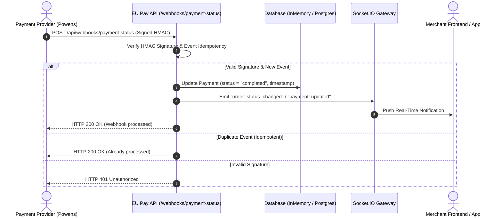

# Test Plan: Payment Webhook Flow

## 1. Test Scope

### In Scope
- **Webhook Endpoint Lifecycle:** Complete end-to-end testing of `POST /api/webhooks/payment-status`.
- **Security & Integrity:** Cryptographic signature verification using HMAC-SHA256, secret isolation, replay attack mitigation, and injection sanitization.
- **State Synchronization & Idempotency:** Consistent transition of payment statuses (`pending` -> `completed`, `failed`, `cancelled`), duplicate event deduplication via `event_id`, and concurrency handling.
- **Downstream Persistence & Events:** Updates to internal payment records, timestamp recording (`webhook_received_at`), and real-time Socket.IO notification propagation.
- **Error Handling & Negative Scenarios:** Missing signatures, malformed payloads, non-existent payment IDs, and edge case parameters.

### Out of Scope
- Frontend client user interface rendering (tested via REST/Socket.IO consumers directly).
- Volumetric load and stress testing exceeding 10,000 requests/second.
- Upstream payment provider banking rail execution (Powens/Bridge internal banking APIs).

---

## 2. Test Environment

| Component | Specification |
|---|---|
| **API Runtime** | Node.js 20+ / Express REST API (`http://localhost:3000`) |
| **Real-Time Gateway** | Socket.IO Server (`ws://localhost:3000`) |
| **Database** | In-memory transactional test store (`src/db/database.js`) |
| **HMAC Secret** | `test-webhook-secret-key` |
| **Test Automation** | Node.js native test runner (`node:test`) + `supertest` |
| **Manual Simulators** | `curl`, Postman Collection (`postman-collection.json`) |

---

## 3. Test Scenarios (Minimum 12 Scenarios)

| # | Scenario | Test Objective | Test Input / Action | Expected Result |
|---|---|---|---|---|
| **1** | **Valid Webhook with Correct Signature** | Verify happy-path webhook ingestion | Valid payload signed with HMAC-SHA256 of `WEBHOOK_SECRET` | `200 OK`, `success: true`, payment status updated to `completed` |
| **2** | **Webhook with Invalid Signature** | Verify rejection of spoofed requests | Valid payload with forged/tampered `x-webhook-signature` | `401 Unauthorized`, `error: "Invalid signature"`, no state change |
| **3** | **Duplicate Webhook (Same event_id Twice)** | Verify idempotency enforcement | Send identical webhook payload with same `event_id` twice | First returns `200 OK (Webhook processed)`, second returns `200 OK (Already processed)` without duplicate mutation |
| **4** | **Webhook for Non-Existent Payment** | Verify behavior on unknown payment entity | Webhook with valid signature for `payment_id: "unknown_9999"` | `404 Not Found`, `error: "Payment not found"` |
| **5** | **Webhook Arrives Before Payment Created** | Handle asynchronous out-of-order delivery | Webhook arrives before client payment creation completes | `404 Not Found` (in real prod: queued for retry with exponential backoff) |
| **6** | **Multiple Webhooks for Same Payment (Different Statuses)** | Verify valid state lifecycle progression | Send webhook transitioning from `pending` -> `processing` -> `completed` | Status smoothly updates sequentially in database with latest timestamp |
| **7** | **Webhook with Missing Required Fields** | Validate input sanitization and schema check | Payload missing `payment_id` or `status` | `400 Bad Request`, `error: "payment_id and status required"` |
| **8** | **Webhook with Malformed JSON** | Verify parser resilience against invalid bodies | Request sent with `Content-Type: application/json` and broken JSON string | `400 Bad Request` or Express JSON syntax error handled gracefully, no crash |
| **9** | **Concurrent Webhooks (Race Condition)** | Verify thread-safety and race condition prevention | Fire 10 simultaneous requests with identical `event_id` | Exactly 1 request executes state change; 9 return idempotent `Already processed` |
| **10** | **SQL Injection Attempt in payment_id** | Verify resilience against SQLi / query injection | `payment_id: "1' OR '1'='1"` | Sanitized / looked up as literal string key; returns `404 Not Found` safely |
| **11** | **Webhook Signature Timing Attack** | Protect against string comparison timing leaks | Measure response latency differences across matching byte lengths | Constant-time comparison (`crypto.timingSafeEqual`) ensures uniform response times |
| **12** | **Webhook Replay Attack (Old event_id)** | Prevent replaying stale historical events | Send previously processed webhook event after significant time delay | Rejected or returned as idempotent no-op; status not regressed |

---

## 4. Security Tests

### 4.1 HMAC-SHA256 Signature Verification
- **Test:** Generate signatures with incorrect secrets, altered payload keys, or whitespace variations.
- **Validation:** Only byte-exact payloads signed with the pre-shared secret are admitted through middleware.

### 4.2 Replay Attack Prevention
- **Test:** Replay previously acknowledged webhooks with varying delay windows.
- **Validation:** Storage of processed `event_id`s in deduplication storage guarantees replays cannot re-trigger merchant credits or inventory release.

### 4.3 Injection Vulnerabilities (SQLi & NoSQLi)
- **Test:** Send payloads containing `{"payment_id": {"$gt": ""}}`, `' UNION SELECT ... --`, or `drop table payments;`.
- **Validation:** Inputs are strictly typed or string-matched against sanitized primary keys.

### 4.4 Cross-Site Scripting (XSS) in Status / Metadata
- **Test:** Inject script payloads into free-text fields: `status: ""`.
- **Validation:** Status values must be strictly whitelisted against an allowed enum (`pending`, `completed`, `failed`, `cancelled`).

---

## 5. Edge Cases

### 5.1 Very Large payment_id
- **Test:** Supply a 2048-character string for `payment_id`.
- **Expected:** Endpoint handles parsing without memory overflow and returns `404 Not Found` gracefully.

### 5.2 Unicode Characters in Status
- **Test:** Provide emoji or multi-byte unicode strings (`status: "completed ✅"` or `status: "支付成功"`).
- **Expected:** Non-standard status strings are rejected if not in allowed status enum.

### 5.3 Null, Empty, or Missing event_id
- **Test:** Webhook delivered without an `event_id` property.
- **Expected:** If payment provider omits `event_id`, fallback idempotency keys (e.g. `payment_id + status`) prevent duplicate side effects.

### 5.4 Future Timestamps
- **Test:** Payload containing timestamps set 10 years in the future.
- **Expected:** Ingestion timestamp recorded on the server must use trusted server clock (`new Date()`).

---

## 6. Integration Tests

### 6.1 End-to-End Payment State Update
1. Create payment with status `pending`.
2. Dispatch signed webhook with status `completed`.
3. Query `GET /api/payments/:id` to assert `status === "completed"` and `webhook_received_at` is populated.

### 6.2 Real-Time Socket.IO Notification
1. Connected merchant client joins room `merchant_1`.
2. Payment webhook arrives for merchant 1's payment.
3. Assert that Socket.IO gateway emits `order_status_changed` or `payment_completed` event to the subscribed client room.

### 6.3 Retry Logic & Unavailability Simulation
1. Simulate temporary database outage or 500 error.
2. Provider retries with exponential backoff (e.g., 5s, 30s, 5m).
3. Once database recovers, retry request succeeds and updates status with exactly-once semantic guarantee.

---

## 7. Risk Assessment & Production Mitigation

| Risk | Production Impact | Detection Strategy | Mitigation Strategy |
|---|---|---|---|
| **Webhook Secret Leakage** | Attackers could forge completed payments and steal goods | Anomalous webhook volume from unexpected IP addresses; failed MAC alerts | Store secret in AWS Secrets Manager / Vault; enforce IP whitelisting for payment provider IP CIDR blocks; support dual-key rotation. |
| **Out-of-Order Webhooks** | `failed` arrives before `processing`, causing incorrect final status | Audit log mismatch between provider transaction logs and local states | Enforce state-machine transition validation (e.g. terminal states `completed` or `failed` cannot be overwritten by `pending`). |
| **Replay & Concurrency Floods** | Duplicate credits, double inventory decrements | Distributed lock contention alerts; high duplicate `event_id` count in logs | Use Redis distributed locks (`SET key val NX EX 30`) keyed on `event_id` before database transaction execution. |
| **Provider Webhook Outage / Silent Failure** | Orders remain in `pending` indefinitely | Metric alarm: `Count(pending_payments > 15m) > threshold` | Implement automated polling reconciliation cron job calling Powens AIS/PIS API every 15 minutes to reconcile missed webhooks. |
